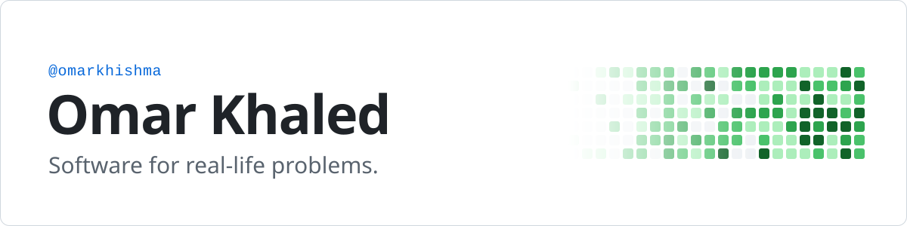

<a href="https://github.com/omarkhishma">
  <picture>
    <source media="(max-width: 767px) and (prefers-color-scheme: dark)" srcset="./assets/banner-dark-mobile.svg">
    <source media="(max-width: 767px)" srcset="./assets/banner-light-mobile.svg">
    <source media="(prefers-color-scheme: dark)" srcset="./assets/banner-dark.svg">
    
  </picture>
</a>

Right now I'm working on two things: making the language of the Quran explorable word by word, and giving charities a shared, verifiable view of the aid they deliver.

### Building

**[JudhurQuran](https://github.com/omarkhishma/JudhurQuran)** · TypeScript · Python  
A Quran explorer built on Arabic morphology (ʿilm al-ṣarf). Every word is selectable text in an authentic Quranic script and opens its linguistic root, the forms derived from it, and every place that root appears.

**[charity-db-platform](https://github.com/omarkhishma/charity-db-platform)** · In design  
A coordination layer for Jordan's charitable sector: a shared, household-level beneficiary registry and disbursements routed through licensed payment rails, so aid reaches the families who need it most instead of concentrating on the same few.

### Stack

<code>TypeScript</code> <code>React</code> <code>Next.js</code> <code>Tailwind CSS</code> <code>Python</code> <code>PostgreSQL</code> <code>OpenSearch</code> <code>Docker</code> <code>Playwright</code>
